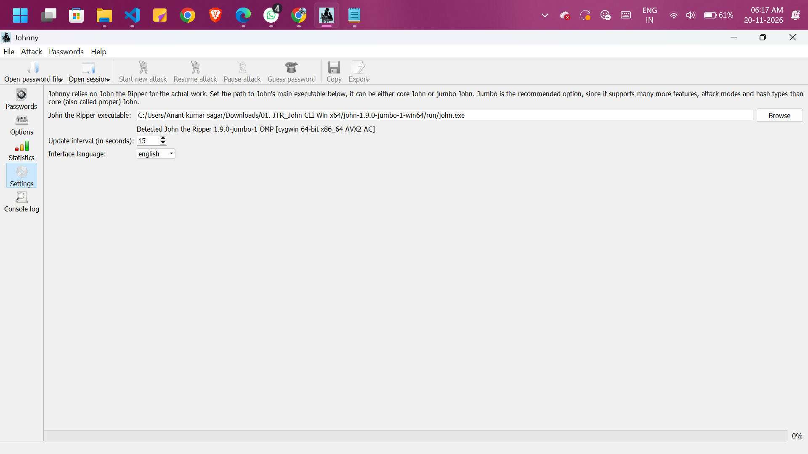
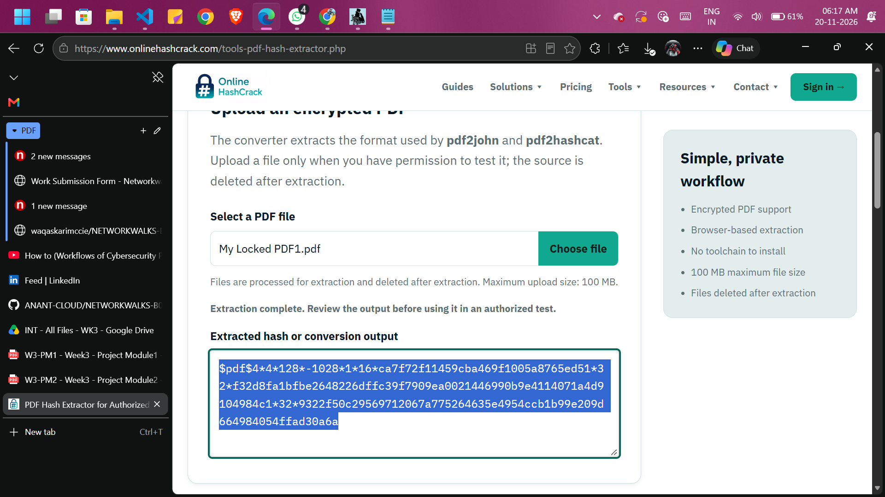
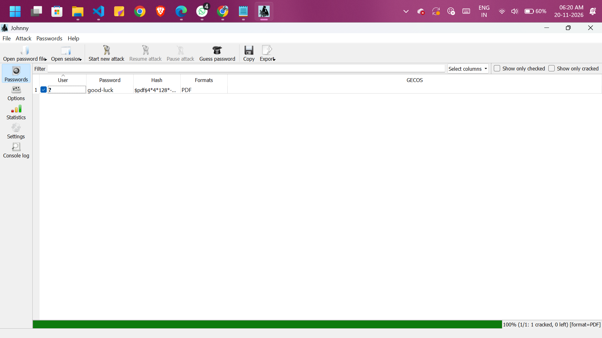
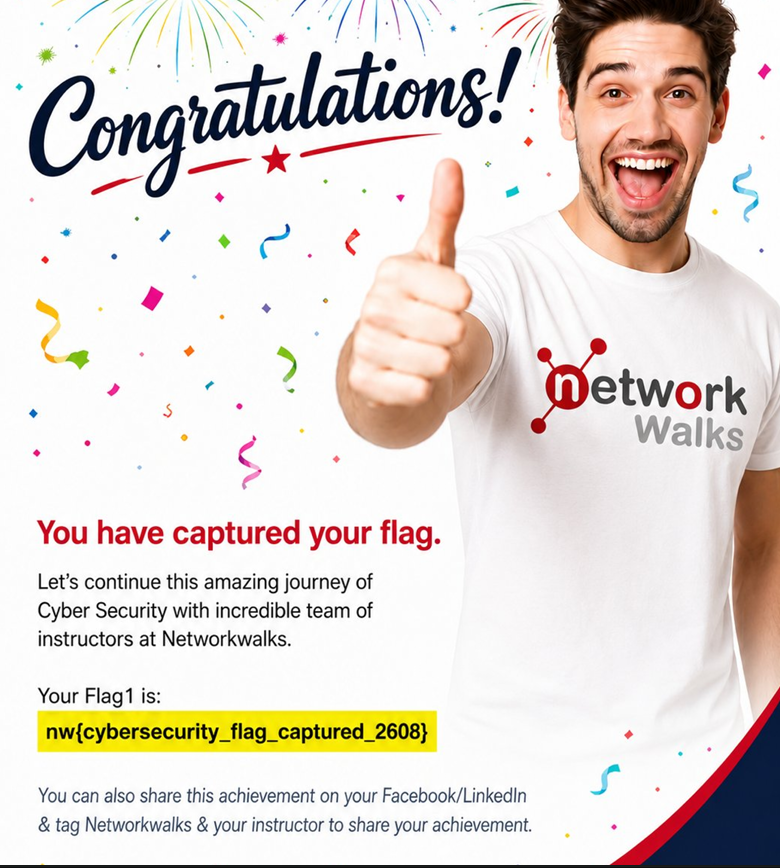

# NETWORKWALKS-B084J-WK3-PM1-PASSWORD-CRACKING-JTR

Password Cracking with John the Ripper (JTR)

**Recovering the password of a protected PDF file using JTR John and the Johnny GUI**

## Project Overview

This project focuses on **password cracking** using **John the Ripper (JTR)**, a well-known password recovery tool used by security professionals to test how strong passwords are. JTR started as a Unix tool and now runs on Windows, Linux and Mac. It can check many hash types and unlock password-protected files such as PDF, ZIP and Office documents.

**Johnny** is the graphical version of JTR. It gives a simple point-and-click interface, so JTR can be used without typing long commands.

The task was to crack the password of a protected file, `My Locked PDF1.pdf`, using JTR John and Johnny on a Windows PC.

## Objectives

The main objectives of this project are to:

- Install John the Ripper (JTR) and the Johnny GUI on Windows.
- Point Johnny to the correct `john.exe` executable.
- Extract a crackable hash from a password-protected PDF.
- Load that hash into Johnny and run a cracking attack.
- Recover the real password and use it to open the PDF.
- Understand how password hashes work and why strong passwords matter.
- Document the process with screenshots and a short write-up.

## Purpose of the Lab

This lab provides a safe, hands-on way to learn **password cracking fundamentals**.

It can be used for activities such as:

- Understanding how password hashes are extracted from protected files
- Learning dictionary-based password recovery
- Practicing with a widely used industry tool (JTR / Johnny)
- Appreciating why weak passwords are cracked quickly

# Lab Setup Procedure

All steps were performed on a Windows PC using Johnny (the JTR GUI). Screenshots were saved as evidence for each step.

## Step 1. Install JTR and Configure Johnny

John the Ripper and the Johnny GUI were downloaded from the official Openwall sources and installed on Windows. Johnny was then pointed to the John the Ripper executable (`john.exe`) under Settings.



**Result:** Johnny detected `John the Ripper 1.9.0-jumbo-1 OMP [cygwin 64-bit x86_64 AVX2 AC]` at the configured path.

## Step 2. Extract the Hash from the Locked PDF

The protected file `My Locked PDF1.pdf` was uploaded to the Online Hash Crack PDF Hash Extractor (`onlinehashcrack.com/tools-pdf-hash-extractor.php`), which uses the same extraction method as `pdf2john`. The tool returned a crackable hash in `$pdf$...` format.

```
https://www.onlinehashcrack.com/tools-pdf-hash-extractor.php
```



**Result:** A hash starting with `$pdf$4*4*128*-1028*1*16*...` was extracted and saved into a text file (`hash1.txt`) for use with Johnny, exactly as the hash starts with `$pdf$` and contains no extra characters.

## Step 3. Crack the Hash with Johnny

The saved hash file was opened in Johnny using **Open password file**, and the attack was started with **Start new attack**.



**Result:** Johnny cracked the hash at **100% (1/1: 1 cracked, 0 left) [format=PDF]**. The recovered password is **`good-luck`**.

## Step 4. Open the PDF with the Cracked Password

The cracked password was entered into the PDF's password prompt, unlocking the file and revealing the flag page inside.



**Result:** The PDF opened successfully and displayed:

```
Your Flag1 is: nw{cybersecurity_flag_captured_2608}
```

# 🔎 Lab Verification

| ✅ Test                     | 🧾 Action                                   | 🎯 Expected Result                         |
| --------------------------- | -------------------------------------------- | ------------------------------------------ |
| ⚙️ Johnny configured         | Browse to `john.exe` in Settings              | John the Ripper version detected            |
| 🔑 Hash extracted            | Upload PDF to the hash extractor              | Hash starting with `$pdf$...` returned      |
| 🗂️ Hash file loaded          | Open password file (`hash1.txt`) in Johnny    | Hash listed with format `PDF`               |
| 🧨 Attack run                | Start new attack                              | Progress bar reaches 100%, 1 cracked        |
| 🔓 PDF unlocked              | Enter cracked password in the PDF prompt      | PDF opens and shows the flag page           |

## Summary of Results

```
Target file:       My Locked PDF1.pdf
Hash format:       $pdf$ (PDF, pdf2john-compatible)
Tool used:         John the Ripper (Johnny GUI)
Cracked password:  good-luck
Flag captured:     nw{cybersecurity_flag_captured_2608}
```


> **Important:** When copying the hash, make sure it starts exactly with `$pdf$` with no extra characters such as a leading `b'`, or the attack will fail to load.

# What I Learned

Through this project, I learned how password cracking tools recover passwords from protected files.

The most important concepts I learned include:

### 1. Hashing vs. Encryption

Encryption is two-way: what is encrypted can be decrypted with the correct key. Hashing is one-way: it scrambles data into a fixed digest that cannot be reversed directly, which is why cracking tools must guess passwords and compare hashes instead.

### 2. Extracting a Crackable Hash

A locked PDF does not store its password directly; a hash representing it must first be extracted (using the same method as `pdf2john`) before any cracking tool can work on it.

### 3. Dictionary-Based Cracking

Johnny/JTR tries candidate passwords against the hash until one matches. Short or common passwords such as `good-luck` are cracked almost instantly, which demonstrates why weak passwords are a serious risk.

### 4. GUI vs. Command Line

Johnny made it possible to run JTR without typing commands, which is useful for beginners, while still using the same John the Ripper engine underneath.

### 5. Documentation

Saving screenshots of each step, including the hash, the attack progress and the final flag, is an important part of a professional cybersecurity write-up.

# Security & Ethical Use

This laboratory is intended strictly for education purposes only. Password cracking was performed only on the file provided for this course exercise. Never attempt to crack passwords or unlock files you do not own or do not have explicit permission to test.

# Author

**ANANT KUMAR SAGAR**  
Cybersecurity Student B084J

LinkedIn: [https://www.linkedin.com/in/anantkumarsagar/](https://www.linkedin.com/in/anantkumarsagar/)

## Project Information

**Program Name:** Cybersecurity at Networkwalks | **Week:** 03 | **Project:** Password Cracking with John the Ripper (JTR) | **Repository:** GitHub
